# Database design (PostgreSQL 16)

Migrations live in `server/migrations/` and are applied by `npm run migrate`:
- `0001_core.sql` creates the tables, constraints, indexes and triggers;
- `0002_reference_data.sql` adds districts, permissions, roles and default settings.

They are **forward-only**. Each one is checksum-guarded, runs in its own transaction, and an advisory lock means two deploys can never migrate at the same time.

## Entity–relationship diagram

```mermaid
erDiagram
  shops ||--o{ categories : "has"
  shops ||--o{ products : "owns (internal department)"
  categories ||--o{ categories : "parent"
  categories ||--o{ products : "groups"
  import_countries ||--o{ products : "origin"
  products ||--|{ product_variants : "sizes / options (SKU)"
  products ||--o{ product_images : "up to 8"
  product_variants ||--|| inventory : "stock row"
  product_variants ||--o{ inventory_movements : "append-only history"
  collections ||--o{ collection_products : ""
  products ||--o{ collection_products : ""
  customers ||--o{ customer_auth_identities : "password / google"
  customers ||--o{ customer_addresses : ""
  customers ||--o{ customer_sessions : ""
  customers ||--o{ customer_tokens : "verify / reset"
  customers ||--o| carts : ""
  carts ||--o{ cart_items : ""
  customers ||--o{ orders : "optional (guests allowed)"
  districts ||--o{ orders : "ship_district"
  orders ||--|{ order_items : "price snapshot (append-only)"
  orders ||--o{ order_status_history : "timeline (append-only)"
  orders ||--o{ stock_reservations : "held stock"
  orders ||--o{ payments : "one per method"
  payments ||--o{ payment_events : "PayHere notifications (append-only)"
  orders ||--o{ refunds : ""
  orders ||--o{ shipments : ""
  shipments ||--o{ shipment_events : ""
  coupons ||--o{ coupon_redemptions : ""
  orders ||--o| coupon_redemptions : ""
  staff_users ||--o{ staff_roles : ""
  roles ||--o{ staff_roles : ""
  roles ||--o{ role_permissions : ""
  permissions ||--o{ role_permissions : ""
  staff_users ||--o{ staff_shop_access : "department scope"
  shops ||--o{ staff_shop_access : ""
  staff_users ||--o{ staff_sessions : ""
```



Tables not drawn above, which stand alone: `site_content`, `banners`, `globe_settings`, `flash_sale_rules`, `shipping_rates`, `payment_settings`, `audit_logs` (append-only), `backup_job_status` and `schema_migrations`.

## Key rules enforced by the database (not only by the app)

| Rule | How |
|---|---|
| Money is never floating point | All amounts are `bigint` cents. `orders` has `CHECK (total = subtotal − discount + shipping)`, and `order_items` has `CHECK (line_total = unit_price × qty)` |
| Stock can never go negative or be over-reserved | `inventory`: `CHECK (on_hand >= 0)`, `CHECK (reserved >= 0)`, `CHECK (reserved <= on_hand)`. Checkout locks inventory rows `FOR UPDATE` in a fixed order (no deadlocks) and uses conditional updates |
| Unique business keys | `orders.order_number`, `product_variants.sku`, `products.slug`, `(payments.provider, provider_payment_id)`, `payment_events.dedupe_key` (PayHere duplicates), `orders.idempotency_key` (double-click), `coupons.code` |
| History cannot be edited | Triggers reject `UPDATE`/`DELETE` on `audit_logs`, `inventory_movements`, `order_items`, `order_status_history` and `payment_events` |
| Max 8 photos per product | Trigger on `product_images` |
| Safe content | Colours must be `#hex`, and banner links must start with `#`, `/` or `https://` (`CHECK` constraints) |
| One owner always exists | Enforced in the staff API transaction |

## Delete and cascade policy

- **Products are never deleted by staff.** "Delete" sets `status = 'archived'`. `order_items` keep a full snapshot (name, SKU, price, department), and `inventory_movements` reference variants with `ON DELETE RESTRICT`. Old orders, payments and stock history therefore stay complete.
- **Orders, payments, refunds and shipments use `ON DELETE RESTRICT` everywhere.** A paid order cannot be removed by any routine cleanup. Cancelling changes the status and adds history rows.
- **`CASCADE` is used only for data with no meaning on its own:** sessions, tokens, addresses and cart items of a deleted customer, `collection_products` when a collection is removed (the products stay), role grants of a removed role mapping, and the images of a product row.
- Categories with products cannot be deleted. They are hidden instead.

## Main indexes (and the screen they serve)

| Index | Used by |
|---|---|
| `products_category_idx` (partial, active only), `products_search_idx` (GIN full text), `products_created_idx` | Shop listings, search, "new arrivals" |
| `orders_status_idx (status, placed_at desc)`, `orders_placed_idx`, `orders_customer_idx`, `orders_phone_idx` | Admin order tabs, customer history, phone tracking |
| `stock_reservations_active_idx` (partial) | Expiry job every minute |
| `payment_events_ref_idx`, `audit_logs_created_idx`, `audit_logs_entity_idx` | Order detail, Audit Log screen |

## Order and payment states

```text
card (PayHere):  pending_payment ──notify 2──► confirmed ─► processing ─► shipped ─► arrived_lk ─► delivered
                        │  notify -1/-2 or 30 min timeout ─► cancelled / expired (stock released)
bank transfer:   awaiting_bank_transfer ──finance verifies in bank──► confirmed … (48 h hold, then expired)
cash on delivery: confirmed (stock taken) … delivered ; payment_status cod_pending ─► cod_collected
any paid order:  refund (finance) ─► refunded / cancelled, with optional restock
chargeback:      payment_status = chargeback, needs_review = true (no automatic restock)
```

## Mapping from the old browser data (`localStorage`)

| Old (`scg_db_v2`) | New |
|---|---|
| `products[]` (one stock number, `sizes[]`) | `products` + one `product_variants` row per size + `inventory` (stock split evenly so the total is the same) |
| `categories[]`, `collections[]`, `hero[]` | `categories` (with `shops`), `collections` + `collection_products`, `banners` |
| `settings` (texts, menus, sections, FAQ…) | `site_content.storefront`, `globe_settings`, `flash_sale_rules`, `shipping_rates`, `payment_settings`, `import_countries` |
| `settings.adminUser/adminPassHash` | **dropped**: staff accounts are created with `npm run create-owner` |
| `scg_orders_v1`, `scg_profile_v1` | **not imported**: browser orders are unverified and were never paid through a gateway |
